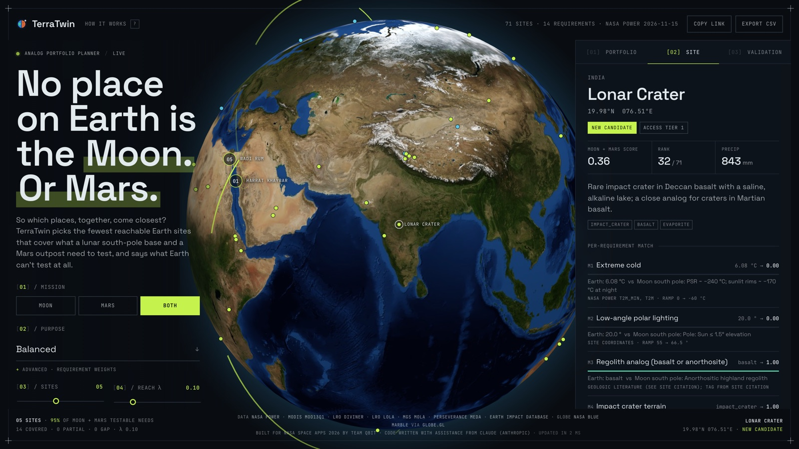

# TerraTwin: Analog Portfolio Planner

**No place on Earth is the Moon or Mars. So which places, together, come closest?**

TerraTwin picks the **smallest set of reachable Earth sites** that together let us test what a lunar south-pole base and a Jezero-like Mars outpost need. It is equally clear about **what no Earth site can test**.

| | |
|---|---|
| **Live app** | **https://terratwin-rust.vercel.app** (no login) |
| **Slides (PDF)** | [presentation/TerraTwin-slides.pdf](presentation/TerraTwin-slides.pdf) |
| **Challenge** | NASA Space Apps 2026: *Identify Earth Locations that Analog the Permanent Moon Base Locations and Mars* |
| **Team** | QBIT |



---

## The idea

Analog lists usually rank single "best matches", but every Earth site matches only some factors. Atacama is hyperarid but warm. Haughton Crater is cold but gets rain and snow. So TerraTwin doesn't look for one perfect twin. It:

1. **Breaks each base into 14 testable requirements**: extreme cold, polar low-angle light, regolith analogs, impact craters, ground ice, lava tubes, barren surfaces, hyperaridity, UV, low pressure, daily temperature swing, basaltic terrain, Jezero-like lakebeds, and dust and wind.
2. **Scores 71 Earth sites (0–1) on each requirement** using NASA POWER climate data and cited geology.
3. **Builds a portfolio** of the fewest sites that cover the most weighted requirements, with a penalty for hard-to-reach sites.
4. **Lists what Earth can't test**, never scored and always shown: reduced gravity, vacuum and a thin CO₂ atmosphere, 40 K shadowed craters, charged lunar dust, cosmic radiation, the two-week lunar night.

**How it maps to the challenge:**

| The challenge asks to… | TerraTwin |
|---|---|
| Identify new analogs | 55 of the 71 sites are **New candidates** (not yet used as analogs). A one-click filter shows only them. |
| Characterize them | Every site has a card with the raw NASA value and score for all 14 requirements, Earth vs Moon/Mars target values, and sources. |
| Present as a map or tool | An interactive 3D globe, with mission, purpose, portfolio-size and reachability controls. Shareable links and CSV export. |

## Results

With **Mission = Moon + Mars**, the **Balanced** preset and a reachability penalty of λ = 0.10:

| Pick | Site | Status | Gain added |
|---|---|---|---|
| 1 | Harrat Khaybar, Saudi Arabia | New candidate | +7.12 |
| 2 | Haughton Crater, Canada | Known analog | +4.01 |
| 3 | Ojos del Salado, Chile | New candidate | +0.98 |
| 4 | Allan Hills, Antarctica | New candidate | +0.48 |
| 5 | Wadi Rum, Jordan | New candidate | +0.03 |

- **5 sites cover 95% of the weighted, testable Moon + Mars needs**, and 4 of the 5 are new candidates.
- **The gains shrink quickly** (7.12 → 0.03). The app stops early when another site would only duplicate coverage.
- **Moon only:** Haughton, Harrat Khaybar, Allan Hills and Wadi Rum (96%).
- **Mars only:** Licancabur, El Malpais, Lonar Crater (India), Allan Hills and Puga Valley (India) (95%).

### Validation

We checked the method against 16 sites already used as Moon or Mars analogs. Each is ranked among all 71 candidates on the mission it is documented for.

- **12 of 16 rank in the top half; 7 of 16 rank in the top 25%.**
- **That is below the 60% we targeted.** We report the honest number rather than tune thresholds until it passes.
- **The low-ranked analogs were chosen for things TerraTwin doesn't score:** acid-mine chemistry (Rio Tinto), underwater EVA operations (Pavilion Lake), carbonate mineralogy (Svalbard) and habitat logistics (MDRS).
- **The top new candidates rank right alongside the known sites.** For the Moon: Mount Erebus (Ross Island), Mistastin Lake Crater and Tolbachik. For Mars: Licancabur, Ojos del Salado and Monturaqui Crater.

Run it yourself with `node tests/validate.mjs`.

## How it works

**Scoring.**
- Climate requirements use a linear ramp: `s = clip((x − zero) / (full − zero), 0, 1)`. The thresholds are set relative to Earth's extremes, because no Earth value reaches Moon or Mars values.
- Geology requirements use tags: a primary tag scores 1.0 (e.g. `lava_tube`), a partial tag 0.5 (e.g. `cave`).
- Missing data scores 0 and is shown as "no data", never hidden.

**Portfolio.** A greedy solver maximizes

```
Σ_r  w_r · max_{i∈S} s_ir   −   λ · Σ_{i∈S} (access_tier_i − 1),    |S| ≤ k
```

It adds the site with the largest marginal gain each step, and stops at k sites or when no site adds more than 0.01. Greedy max coverage is fast, explainable and within about 63% of optimal.

**Labels.**
- **Status:** a requirement is *covered* when its best score is ≥ 0.7, *partial* at 0.4–0.7, and a *gap* below 0.4.
- **Dual-use:** a site that scores ≥ 0.7 on at least two Moon-only and two Mars-only requirements.

**Presets.** Balanced, Rover and mobility, Habitat and isolation, ISRU and ice, and Astrobiology. Each gives its emphasized requirements a weight of 3 (the rest get 1), and every weight can be edited.

## NASA data used

| Dataset | Used for | URL |
|---|---|---|
| NASA POWER climatology API: T2M, T2M_MIN, T2M_MAX, T2M_RANGE, PRECTOTCORR, ALLSKY_SFC_UV_INDEX, PS, WS10M | Every Earth climate feature (cold, aridity, UV, pressure, daily swing, wind) | https://power.larc.nasa.gov/ |
| LRO Diviner Lunar Radiometer | Moon south-pole temperatures | https://www.diviner.ucla.edu/ |
| LRO LOLA | Moon south-pole terrain and illumination | https://pds-geosciences.wustl.edu/missions/lro/lola.htm |
| LCROSS (Colaprete et al. 2010) | Lunar polar water ice | https://doi.org/10.1126/science.1186986 |
| MGS MOLA | Jezero elevation | https://pds-geosciences.wustl.edu/missions/mgs/mola.html |
| Mars 2020 Perseverance MEDA | Jezero pressure, temperature, wind | https://mars.nasa.gov/mars2020/spacecraft/instruments/meda/ |
| MODIS MOD13Q1 NDVI (ORNL DAAC) | Cited for barren surfaces; planned replacement for the `barren` tag | https://modis.ornl.gov/data/modis_webservice.html |
| NASA Blue Marble | 3D globe imagery | https://visibleearth.nasa.gov/collection/1484/blue-marble |

## Other data, code and tools

- **globe.gl 2.46.2** (MIT, built on three.js), for the 3D globe: https://globe.gl/
- **three-globe** example textures (Blue Marble, topography bump map): https://github.com/vasturiano/three-globe
- **Fonts**: Space Grotesk and JetBrains Mono via Google Fonts (SIL OFL): https://fonts.google.com/
- **Earth Impact Database** (Planetary and Space Science Centre, UNB): http://www.passc.net/EarthImpactDatabase/
- **Papers**:
  - Paige et al. 2010, Diviner cold traps: https://doi.org/10.1126/science.1187726
  - Navarro-González et al. 2003, Mars-like soils in the Atacama: https://doi.org/10.1126/science.1089143
  - Rodriguez-Manfredi et al. 2023, Jezero meteorology (MEDA): https://doi.org/10.1038/s41561-022-01084-0
  - Farley et al. 2022, Jezero floor igneous rocks: https://doi.org/10.1126/science.abo2196
  - Kaku et al. 2017, Marius Hills lava tubes: https://doi.org/10.1002/2017GL074998
- **Per-site citations**: the `citation_url` column of [pipeline/candidates.csv](pipeline/candidates.csv), linked on every site card.
- **Hosting**: Vercel. **Tooling**: Python 3 (pipeline), vanilla JavaScript ES modules (app), Node.js test runner.

## Use of AI (SI disclosure)

- **Code:** written with assistance from **Claude (Anthropic)** via Claude Code: the data pipeline, scoring engine, tests, web app and slide-deck generator.
- **Research:** site research and drafting of site descriptions were assisted by Claude.
- **Data:** every data value comes from the sources listed above and can be traced through the pipeline (`data/cache/` holds the raw NASA POWER responses).
- **Images:** no AI-generated images, video or audio are used. The screenshots are of the app itself, the globe imagery is NASA Blue Marble, and the app icon is a hand-written SVG.
- **Branding:** no NASA logos, flags or mission insignia are used anywhere.

## Run it locally

```bash
python3 -m http.server 8000 -d web        # open http://localhost:8000

# optional: rebuild the data and run the checks
python3 -m pip install -r pipeline/requirements.txt
python3 pipeline/fetch_power.py           # refresh NASA POWER cache (skips cached sites)
python3 pipeline/build_sites.py           # builds web/data/sites.json offline from data/cache/
node --test                               # engine unit tests
node tests/validate.mjs                   # known-analog validation (exits 1 below the 60% target)
```

There's no build step and no backend: `web/` is a static site. The 3D globe needs WebGL; without it the planner still works from the panels.

## Repository layout

```
web/                         static app: index.html, css/, js/engine.js (scoring + greedy), js/app.js (UI + globe), data/sites.json
pipeline/requirements.yaml   14 requirements, thresholds, presets, gap list, with citations
pipeline/targets.yaml        Moon south pole and Jezero profiles (approximate, cited)
pipeline/candidates.csv      71 Earth sites: coordinates, tags, known-analog flag, access tier, citation
pipeline/fetch_power.py      NASA POWER climatology fetcher (cached)
pipeline/build_sites.py      builds web/data/sites.json offline
data/cache/                  raw NASA POWER responses (one per site)
tests/                       unit tests and the validation check
presentation/                slides (PDF + PPTX) and the script that builds them
```

## Method notes and limitations

**Thresholds.** The PRD's starting thresholds were adjusted so that 1.0 means "Earth-extreme" (each change is commented in `requirements.yaml`):

| Req | Started at (zero → full) | Now | Why |
|---|---|---|---|
| M1 cold | 0 → −40 °C | 0 → −60 °C | Full score near the coldest site (−62 °C) |
| R1 aridity | 250 → 25 mm/yr | 500 → 0 mm/yr | Semi-arid boundary up to no rain |
| R2 UV | 4 → 10 | 1.5 → 4.5 | POWER's UV index is a 24 h mean; the highest peak month is 4.3 |
| R3 pressure | 95 → 60 kPa | 95 → 50 kPa | Below the lowest site (54 kPa) |
| R4 daily swing | 8 → 20 °C | 6 → 20 °C | Separates polar and maritime sites |
| R7 wind | 2 → 8 m/s | 2 → 10 m/s | Near the windiest sites (~11 m/s) |

**NASA POWER derivations.** All requested parameters were accepted, so no substitutions were needed.
- Precipitation = `PRECTOTCORR` annual mean (mm/day) × 365.
- UV = the highest monthly `ALLSKY_SFC_UV_INDEX`.
- Coldest = the lowest monthly `T2M_MIN`.

**Limitations.**
- **Point sampling, not a global grid.** New candidates come only from the 71 curated sites.
- **Climate is a 0.5° grid-cell average.** Summits are smoothed: Mauna Kea's cell sits at 636 m, not 4,200 m.
- **Geology is tag-based**, from the literature, not mapped lithology.
- **Moon and Mars target values are approximate** and used only for comparison, never for scoring.
- **Some site citations are Wikipedia pages** and should be upgraded to primary papers.

**Next steps.**
- Score a global 0.5° grid to surface new candidates automatically.
- Use MODIS NDVI for barren surfaces instead of the tag.
- Add negative-control sites for a sharper validation.
- Add chemistry and operations requirements.

---

Built for NASA Space Apps 2026 by Team QBIT.
